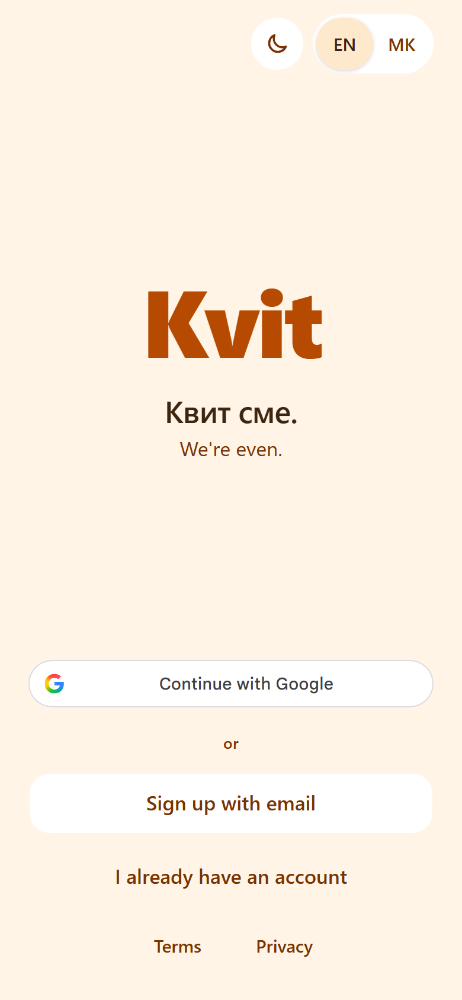
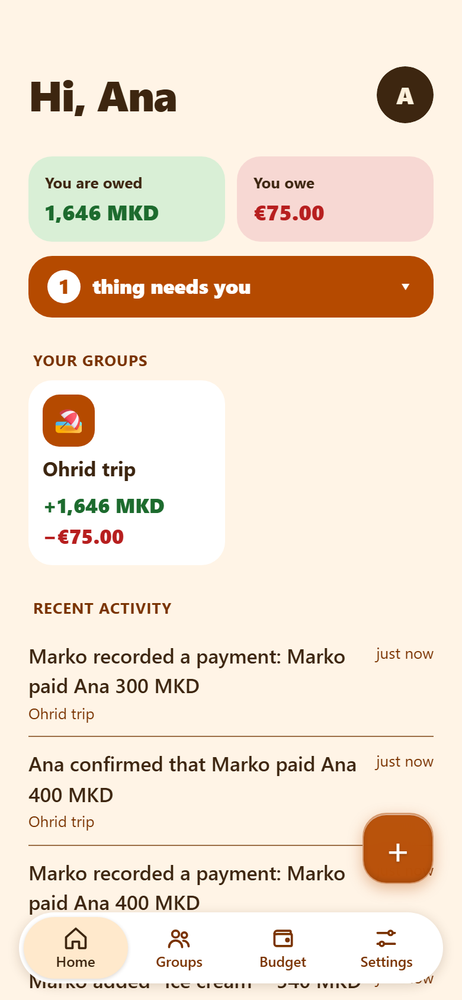
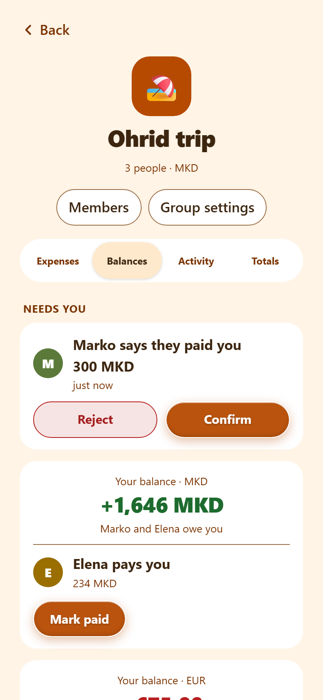
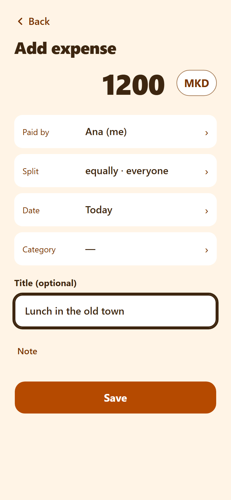
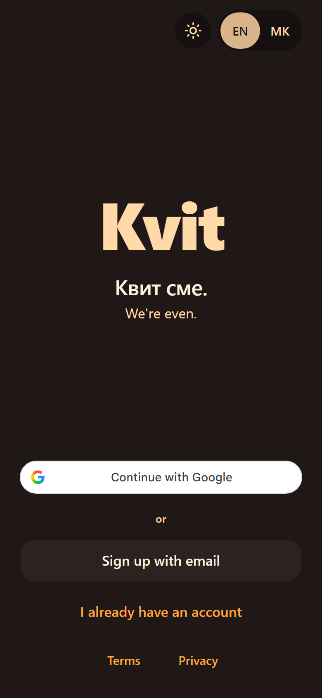
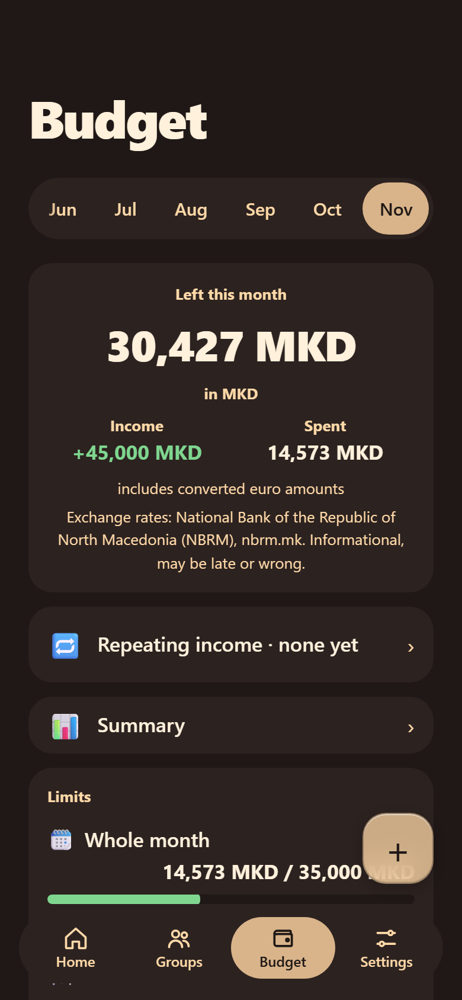
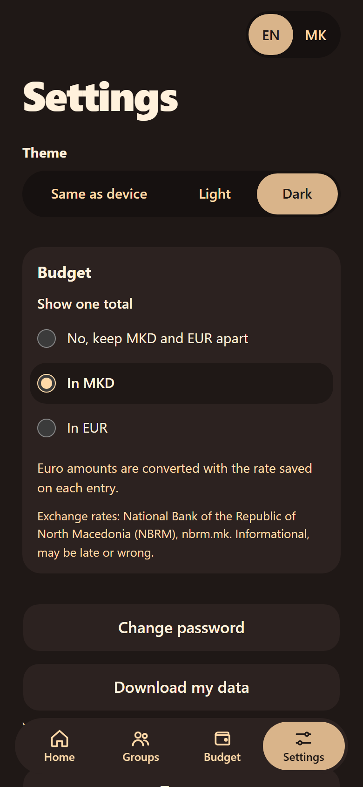
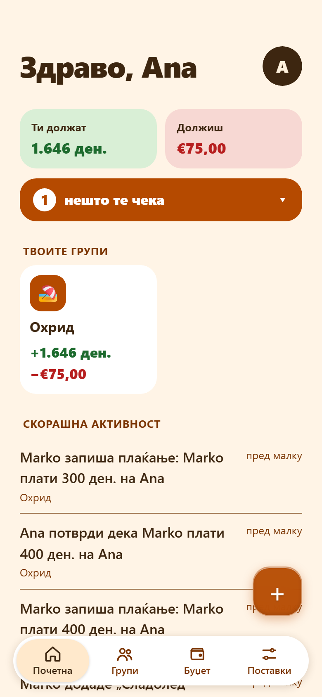

# Kvit

**Квит сме.** ("We're even.")

**Try it: https://kvit-mk.pages.dev**

Kvit splits shared expenses with friends and family, shows who pays whom in as few payments as possible, and keeps a personal budget. It works in **Macedonian denars and euros** and in **English and Macedonian**, on a phone or a desktop, and it is free.

> **Status: live.** Everything in Releases 1 to 3 is released: splitting, the personal budget, and the polish (offline saving, statistics, legal pages and data rights), with all known bugs fixed. The next new features are planned as Release 4 in the [roadmap](docs/ROADMAP.md).

## Screenshots
Real screens of the running app at phone size.

<table>
  <tr>
    <th>Welcome, light</th>
    <th>Home, light</th>
    <th>Who pays whom</th>
    <th>Add expense</th>
  </tr>
  <tr>
    <td></td>
    <td></td>
    <td></td>
    <td></td>
  </tr>
  <tr>
    <th>Welcome, dark</th>
    <th>Budget, dark</th>
    <th>Settings, dark</th>
    <th>Home in Macedonian</th>
  </tr>
  <tr>
    <td></td>
    <td></td>
    <td></td>
    <td></td>
  </tr>
</table>

## What it does
**Splitting with friends**
- **Groups** for a trip or a household, or a quick **One bill** for a single dinner. Share an invite link; friends who don't want an account can join as a **guest** with just a name, and people who never open the app can be added by name.
- **Four ways to split:** equally (with extras, e.g. "Marko took the better room, +600"), exact amounts, percentages and shares.
- **MKD and EUR are never mixed.** Each euro expense keeps the National Bank (NBRM) rate of the day it was saved.
- **Who pays whom**, simplified to as few payments as possible per currency. "I paid Ana" counts once Ana confirms it; Undo instead of "Are you sure?" pop-ups.
- **Activity with change history** ("1,200 → 1,500"), Recently deleted with Restore, and a group can be **closed** once everyone is even (anyone can object within 24 hours).
- **Home** shows what needs you, your totals and the latest activity.

**Personal budget**
- Spending and **income** (once or repeating), custom categories, **monthly limits**, and a monthly summary.
- Your **share of group expenses** is counted in your budget automatically, in your chosen budget currency, with a warning for possible duplicates.
- Group totals by category and an optional group spending plan.

**Made for a phone and a sleeping free server**
- **Saved data shows instantly**, and changes made while offline or while the server wakes up wait in an **outbox** and are sent later.
- The free server sleeps after 15 minutes; Kvit takes the visitor through the wake-up page and back, or shows a small "The server is asleep" bar in an open tab.
- Can be installed on the home screen. Light (peach) and dark themes, English and Macedonian everywhere.

**Your data**
- Terms of use and a privacy notice in both languages, **Download my data**, and **Delete my account** (removed after 30 days).
- An admin statistics page (no amounts or names) and owner tools for moderation.

## Built for speed
Every screen is judged by how few taps it needs. Adding an expense is **2 taps plus the amount**: the other fields start with the most common choice (paid by me, split equally, today).

## Tech stack
| Part | Technology |
|---|---|
| API | .NET 10, ASP.NET Core Web API, EF Core 10 + PostgreSQL 18, ASP.NET Core Identity (email + password, Google sign-in, guests) |
| Web | React, TypeScript, Vite, TanStack Query, React Router, react-i18next, Tailwind CSS + shadcn/ui, Sonner |
| Tests | xUnit + Testcontainers (a real PostgreSQL in Docker), Vitest, a Playwright smoke check of the built site |
| Hosting | Neon (database), Render (API in Docker), Cloudflare Pages + a Pages Function (website and `/api` forwarding), GitHub Actions (CI and a weekly encrypted backup). All free, with no card |

## Tests and CI
**7,578 backend tests** (xUnit; the database tests run against a real PostgreSQL in Docker through Testcontainers) and **16,425 frontend tests** (Vitest), all passing on 2026-11-20. Same-moment changes (two people editing one expense, two answers to one payment) are tested with real gates that hold both requests at once.

GitHub Actions builds both parts, runs every test and lint (warnings fail the build), checks that no database change is missing a migration, opens the built website in a headless browser, builds the Docker image and, on `main`, applies the migrations to the online database before the new API goes live.

## Interesting parts
- **Money is whole numbers.** Amounts are integer minor units (deni and cents), never floating point. Splits always add up exactly to the total, and a group's balances always add up to zero; both are covered by tests.
- **Clean Architecture + CQRS** with a small hand-written dispatcher instead of MediatR, rich domain entities, and a `Result` pattern instead of exceptions for business rules.
- **Same-moment safety without new columns.** Expenses, payments and groups use Postgres's own `xmin` as a row version; the second of two clashing saves is refused with a clear message or answered from the winner, and anything unexpected answers a clear `SERVER_ERROR` instead of a bare 500.
- **Login across two hosts.** The website and the API live on different domains and Safari blocks cookies between sites, so a Cloudflare Pages Function forwards `/api/*`: the browser sees one site and a secure login cookie works everywhere. Only the website can reach the API (a shared secret), and rate limits count the address the proxy reports.
- **Logins survive restarts.** The keys that sign login cookies are stored encrypted in PostgreSQL, because Render wipes its disk on every restart.
- **Nothing polls the database.** Scheduled work (exchange-rate refresh, finishing a closed group after 24 hours, repeating income, the daily cleanup of deleted accounts) runs lazily on the next request, so the free database can sleep too. `/health` never touches it.
- **Screens load on demand**, and once the app is open every screen is fetched in the background so it keeps working offline.

## Repository layout
```
src/api/     ASP.NET Core API (Api, Application, Domain, Infrastructure, Contracts) and its Dockerfile
src/web/     React app, plus the Cloudflare Pages Function in functions/
tests/       Backend tests (Domain and Api)
scripts/     start-local.ps1 and small owner scripts (password reset, admin role, certificate, backup)
docs/        Decisions, architecture, data model, screens, roadmap, guides, legal texts and reports
```

## Running it locally
You need the .NET 10 SDK, Node.js and Docker Desktop (open). The local database is a PostgreSQL 18 container from `compose.yaml`; first-time setup (user secrets, the database) is in [the local setup guide](docs/guides/phase-04-local-setup.md).

All in one, from the repository root in Windows PowerShell:
```
.\scripts\start-local.ps1          # database, API (http://localhost:5018) and website (http://localhost:5173), opens the browser
.\scripts\start-local.ps1 -Check   # build, all tests, lint, type check and the smoke check; stops at the first failure
.\scripts\start-local.ps1 -Stop    # closes both windows and stops the database (data kept)
```

Or by hand:
- **Backend:** `dotnet run --project src/api/Kvit.Api` (API reference at `/scalar`, health at `/health`). Checks: `dotnet build Kvit.slnx` (0 warnings), `dotnet test Kvit.slnx`.
- **Frontend**, from `src/web` (needs the backend for the `/api` dev proxy): `npm install`, `npm run dev`. Checks: `npm run lint`, `npm run build`, `npm test`, `npm run smoke` (after a build).

## Documentation
- [Decisions](docs/DECISIONS.md): every product rule and the reasons behind it
- [Architecture](docs/ARCHITECTURE.md): how the code is structured, and the traps found while building
- [Data model](docs/DATA-MODEL.md): tables and money rules
- [Screens](docs/SCREENS.md): every screen and its tap count
- [Roadmap](docs/ROADMAP.md), [status](docs/STATUS.md) and [backlog](docs/BACKLOG.md)
- [Reports](docs/reports/): what each phase built and how it was checked
- [Legal](docs/legal/): the published terms and privacy versions, vendors and the record of processing

## License
© 2026 Filip Davchev. All rights reserved. You're welcome to read the code, but no licence to reuse it is granted yet.
